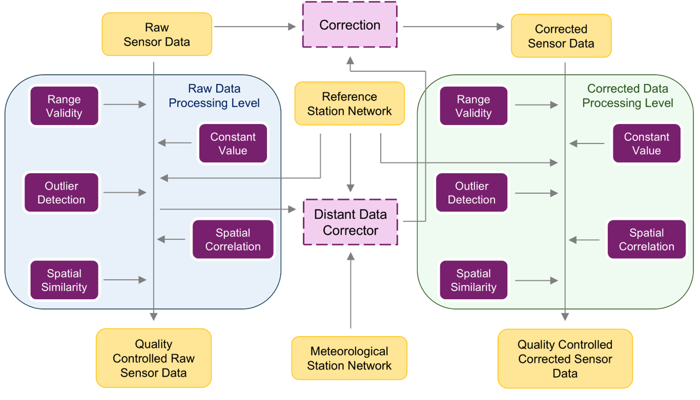

# rFILTER

**rFILTER** is the R implementation of the Framework for Improving Low-cost Technology Effectiveness and Reliability (FILTER). It provides a set of algorithms to harmonize, quality-check, flag and correct in situ observations from outdoor, static, crowdsourced sensors.

FILTER was originally developed for the quality control (QC) and correction of fine particulate matter observations (i.e., particles with a diameter smaller than 2.5 &mu;m, PM<sub>2.5</sub>) from static low-cost sensors, and with further refinement it can be adapted to other environmental parameters. Its statistical algorithms address the heterogeneity and variable reliability of measurements across different sensor networks.

The methodology of FILTER is summarized in the figure below:

<p align="center">
  
</p>

FILTER has two processing levels, <i>Raw</i> and <i>Corrected</i>, and QC is applied at both:

- **Raw level**: the QC procedure is applied directly to the sensor observations.
- **Corrected level**: The sensor observations are corrected, and the QC procedure is then applied to the corrected observations. The correction requires auxiliary data from reference instruments and, optionally, from meteorological stations. Besides the corrected observations and their lower and upper prediction intervals, it provides a quality flag that describes the efficiency of the correction.

The QC procedure consists of five steps. Based on their outcomes, an individual quality flag is assigned at each step to indicate the reliability of each measurement. This hierarchical design allows users to tailor the QC process to the availability and characteristics of the data, and to the needs of each application.

The functionalities of FILTER and its evaluation are described in: [A scalable framework for harmonizing, standardizing, and correcting crowdsourced low-cost sensor PM<sub>2.5</sub> data across Europe](https://www.sciencedirect.com/science/article/pii/S030147972501076X).

## Table of Contents

- [Installation](#installation)
  - [From GitHub](#from-github)
  - [From a local file](#from-a-local-file)
  - [Loading the package](#loading-the-package)
- [Functionalities](#functionalities)
  - [Quality control](#quality-control)
  - [Correction](#correction)
  - [Quality flags](#quality-flags)
- [Dependencies](#dependencies)
- [Data format](#data-format)
  - [Input](#input)
  - [Output](#output)
- [Examples using rFILTER](#examples-using-rfilter)
  - [Step-by-step QC and correction](#step-by-step-qc-and-correction)
  - [Complete QC and correction](#complete-qc-and-correction)

## Installation

### From GitHub

Install the development version of rFILTER from this repository using either the [`remotes`](https://remotes.r-lib.org) or the [`devtools`](https://devtools.r-lib.org) package:

```r
# install.packages("remotes")
remotes::install_github("CitiObs/ValAir-FILTER")

# or, alternatively:
# install.packages("devtools")
devtools::install_github("CitiObs/ValAir-FILTER")
```

### From a local file

Download rFILTER as a `.tar.gz` file and install it in your R environment with the [`remotes`](https://remotes.r-lib.org) package, which also installs the required R packages:

```r
# install.packages("remotes")
remotes::install_local("path/to/rFILTER_x.y.z.tar.gz")
```

Alternatively, install it with base R. In this case, the required R packages (see [Dependencies](#dependencies)) must be installed beforehand:

```r
install.packages("path/to/rFILTER_x.y.z.tar.gz", repos = NULL, type = "source")
```

Replace `path/to/rFILTER_x.y.z.tar.gz` with the actual path and file name.
### Loading the package

Once the installation is complete, load the package with:

```r
library(rFILTER)
```

## Functionalities

The QC and correction algorithms and their main helper functions are listed below. A detailed description of each function, including its mathematical formulation, its arguments and its output, is given in its help page (e.g., `?spatial_similarity_qctest` or `help("correction_process")`).

### Quality control

| Test | Description | Function | Main helper functions |
|:---|:---|:---|:---|
| Range Validity | Flags values outside physically realistic limits | `range_validity_qctest()` | |
| Constant Value | Flags persistent (constant) values | `constant_value_qctest()` | |
| Outlier Detection | Flags temporal and spatial outliers | `outlier_qctest()` <br> `spatial_outlier_qctest()` | |
| Spatial Correlation | Flags values that are not correlated with those of neighboring sensors or reference stations | `spatial_correlation_qctest()` | `expected_correlation()` |
| Spatial Similarity | Flags values that are not similar to those of the closest reference stations | `spatial_similarity_qctest()` | `expected_similarity()` |
| Quality Flag | Assigns a total quality flag based on the individual flags of the QC tests | `quality_flag_function()` | |

### Correction

| Description | Function | Main helper functions |
|:---|:---|:---|
| Corrects the sensor observations using nearby reference stations and, optionally, meteorological stations | `correction_process()` | `find_neighbors()` <br> `modified_idw_function()` <br> `min_variability_function()` <br> `correction_function()` |

### Quality flags

Each QC test adds a flag column to the dataset. The flag values that mark a valid measurement are shown in **bold**.

|Process |Test |Flag column |Flag values |
|:---|:---|:---|:---|
| Quality control | Range Validity | `flag_range` | `0` out of range <br> **`1` within range** |
| | Constant Value | `flag_constant_value` | `0` insufficient data <br> `1` constant <br> **`2` not constant** |
| | Outlier Detection | `flag_outlier` | `0` insufficient data <br> `1` outlier <br> **`2` not an outlier** |
| | Spatial Correlation | `flag_correlation` | `0` insufficient data <br> `1` isolated site <br> `2` not correlated with the neighboring sensors or reference stations <br> **`3` correlated with the neighboring sensors or reference stations** |
| | Spatial Similarity | `flag_similarity` | `0` insufficient data <br> `1` isolated site <br> `2` not similar to the neighboring reference stations <br> **`3` similar to the neighboring reference stations** |
| | Total quality flag | `quality_flag` | `0` other quality <br> **`1` good quality** <br> **`2` high quality** |

The correction process also adds a flag column to the dataset. The flag value that marks an efficient correction is shown in **bold**.

| Process | Flag column | Flag values |
|:---|:---|:---|
| Correction | `flag_correction` | `0` insufficient data <br> `1` isolated site <br> `2` no improvement over the <i>Raw</i> observations <br> **`3` improvement over the <i>Raw</i> observations** |

The complete workflow of each processing level can be run with a single call: `runFILTER_raw_level()` for the <i>Raw</i> level and `runFILTER_corrected_level()` for the <i>Corrected</i> level.

## Dependencies

The required R packages are listed in the `Imports` field of [DESCRIPTION](DESCRIPTION). They are installed automatically when rFILTER is installed from GitHub or with `remotes::install_local()`. When rFILTER is installed with `install.packages(..., repos = NULL)`, they must be installed beforehand.

## Data Format

### Input

rFILTER supports datasets stored as a `data.frame` or a `tibble`. The functions do not require predefined column names: each column is assigned to its role through a function argument (for example, `id.column = "id"`). A dataset should contain the measurement location (e.g., ID or name, longitude and latitude) and the measurements (e.g., timestamp and value).

The example below uses the [network_sensor_data](data/network_sensor_data.rda) dataset included in the package:

```r
library(rFILTER)
data(network_sensor_data)
head(network_sensor_data)
tail(network_sensor_data)
```

| id | timestamp | longitude | latitude | PM2.5 |
|:---|:---|:---|:---|:---|
| 348 | 2023-12-15 00:00:00 | 10.74 | 59.94 | 2.6 |
| 348 | 2023-12-15 01:00:00 | 10.74 | 59.94 | 2.9 |
| 348 | 2023-12-15 02:00:00 | 10.74 | 59.94 | 1.5 |
| ... | ... | ... | ... | ... |
| 68 | 2024-01-11 00:00:00 | 10.75 | 59.91 | 9.4 |
| 68 | 2024-01-11 01:00:00 | 10.75 | 59.91 | 13.8 |
| 68 | 2024-01-11 02:00:00 | 10.75 | 59.91 | 25.8 |

The columns are assigned to the function arguments as follows:

| Column | Type | Description |
|:---|:---|:---|
| `id` | numeric | Identifier (ID) of the measurement location |
| `timestamp` | POSIXct | Timestamp of each measurement (UTC) |
| `longitude` | numeric | Longitude of the measurement location |
| `latitude` | numeric | Latitude of the measurement location |
| `PM2.5` | numeric | Measurement values (e.g., PM<sub>2.5</sub>, in &mu;g m<sup>-3</sup>) |

Reference and meteorological datasets have the same structure. A meteorological dataset can contain more than one data column (e.g., air temperature and relative humidity).

> [!IMPORTANT]
> Column names can be chosen freely, with one exception: when several datasets are combined (e.g., sensor, reference and meteorological data), the time, longitude and latitude columns must have the same names in every dataset (e.g., `timestamp`, `longitude` and `latitude`).

### Output

Both processing levels return the input dataset with the quality flags of the QC procedure described in [Quality flags](#quality-flags) added. The QC columns are the same at both levels:

| Column | Type | Description |
|:---|:---|:---|
| `flag_range` | numeric | Quality flag of the Range Validity test |
| `flag_constant_value` | numeric | Quality flag of the Constant Value test |
| `flag_outlier` | numeric | Quality flag of the Outlier Detection tests |
| `flag_correlation` | numeric | Quality flag of the Spatial Correlation test |
| `flag_similarity` | numeric | Quality flag of the Spatial Similarity test |
| `quality_flag` | numeric | Total quality flag |

The user can decide which flags are returned: 
- the individual QC flags together with the total quality flag,
- only the total quality flag.

At the <i>Corrected</i> level, the QC is applied to the corrected observations, so the flags above refer to the corrected values. In addition, five columns describe the correction:

| Column | Type | Description |
|:---|:---|:---|
| `flag_correction` | numeric | Quality flag of the correction process |
| `PM2.5_cor` | numeric | Corrected value |
| `PM2.5_cor_lower` | numeric | Lower limit of the prediction interval of the corrected value |
| `PM2.5_cor_upper` | numeric | Upper limit of the prediction interval of the corrected value |

The names of the correction columns start with the name of the data column (here, `PM2.5`).

## Examples using rFILTER

### Step-by-step QC

This [example](https://citiobs.github.io/ValAir-FILTER/example_step_by_step.html) illustrates a step-by-step guide of QC in rFILTER.

### Correction

This [example](https://citiobs.github.io/ValAir-FILTER/example_correction.html) runs the correction algorithm.

### Complete QC and correction workflow using 'ready-to-use' functions

This [example](https://citiobs.github.io/ValAir-FILTER/example_complete.html) runs the complete QC and correction workflow at once, using the ready-to-use functions of each processing level.
