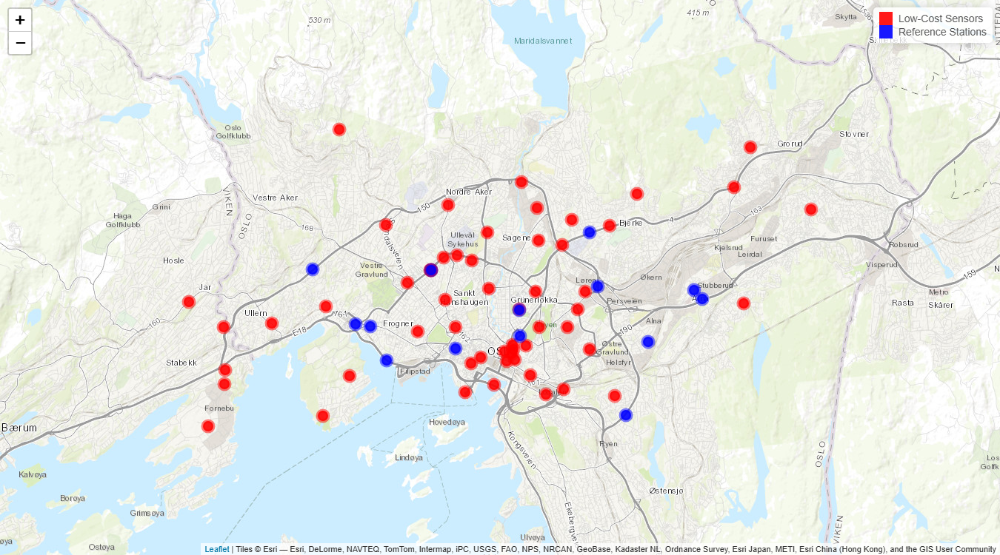
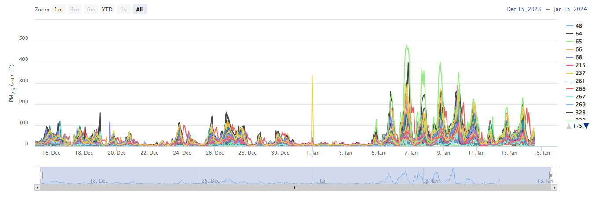

Step-by-step quality control of PM<sub>2.5</sub> sensor observations
using rFILTER
================

# Introduction

This example shows how to apply the quality control (QC) of rFILTER to
PM<sub>2.5</sub> observations from a network of low-cost sensors. The QC
tests are run one at a time, in the order of the FILTER methodology, so
that the effect of each test can be followed:

- Range Validity: `range_validity_qctest()`
- Constant Value: `constant_value_qctest()`
- Outlier Detection: `outlier_qctest()` and `spatial_outlier_qctest()`
- Spatial Correlation: `spatial_correlation_qctest()`
- Spatial Similarity: `spatial_similarity_qctest()`

Finally, the individual flags are combined into a total quality flag
with `quality_flag_function()`. The same workflow can be run with a
single call to `runFILTER_raw_level()`, and the detailed description of
each test is given in its help page (e.g.,
`?spatial_correlation_qctest`).

The example uses two of the sample datasets included in rFILTER:

- `network_sensor_data`: hourly PM<sub>2.5</sub> observations from a
  network of low-cost sensors, which are quality controlled.
- `reference_data`: hourly PM<sub>2.5</sub> observations from reference
  stations, used as high-quality neighbors in the Spatial Correlation
  and Spatial Similarity tests.

# Load package and the available datasets

``` r
library(rFILTER)
library(dplyr)

# Load the sensor/reference/meteorological datasets
data("network_sensor_data")
str(network_sensor_data)
#> tibble [43,659 × 5] (S3: tbl_df/tbl/data.frame)
#>  $ id       : num [1:43659] 348 348 348 348 348 348 348 348 348 348 ...
#>  $ timestamp: POSIXct[1:43659], format: "2023-12-15 00:00:00" "2023-12-15 01:00:00" ...
#>  $ longitude: num [1:43659] 10.7 10.7 10.7 10.7 10.7 ...
#>  $ latitude : num [1:43659] 59.9 59.9 59.9 59.9 59.9 ...
#>  $ PM2.5    : num [1:43659] 2.6 2.9 1.5 0.8 0.4 1.2 3.1 2.5 3 5 ...

data("reference_data")
head(reference_data)
#> # A tibble: 6 × 5
#>      id timestamp           longitude latitude value
#>   <int> <dttm>                  <dbl>    <dbl> <dbl>
#> 1    23 2023-12-15 00:00:00      10.7     59.9  9.05
#> 2    23 2023-12-15 01:00:00      10.7     59.9  5.82
#> 3    23 2023-12-15 02:00:00      10.7     59.9  5.54
#> 4    23 2023-12-15 03:00:00      10.7     59.9  4.36
#> 5    23 2023-12-15 04:00:00      10.7     59.9  5.62
#> 6    23 2023-12-15 05:00:00      10.7     59.9  9.14
```

Both datasets share the same structure: the location identifier (`id`),
its coordinates (`longitude` and `latitude`), the timestamp
(`timestamp`) and the PM<sub>2.5</sub> concentration. The concentration
is stored in `PM2.5` for the sensors and in `value` for the reference
stations.

The map below shows the locations of the sensors and the reference
stations.

``` r
library(leaflet)


sensor_info <- network_sensor_data %>% 
  distinct(id, longitude, latitude)


reference_info <- reference_data %>% 
  distinct(id, longitude, latitude)


sensor.map <- leaflet() %>%
  addProviderTiles("Esri.WorldTopoMap", group = "Topo") %>%
  addCircleMarkers(data = sensor_info,
                   lng = ~longitude, lat = ~latitude,
                   popup = ~paste("<b>ID:</b>", id),
                   stroke = TRUE, color = "red", radius = 7, fillOpacity = 0.9) %>%
  addCircleMarkers(data = reference_info,
                   lng = ~longitude, lat = ~latitude,
                   popup = ~paste("<b>ID:</b>", id),
                   stroke = TRUE, color = "blue", radius = 7, fillOpacity = 0.9) %>%
  addLegend(position = "topright", colors = c("red", "blue"),
            labels = c("Low-Cost Sensors", "Reference Stations"),
            title = NULL, opacity = 0.9)
sensor.map
```

<!-- -->

Time series of <i>‘Raw’</i> sensor PM<sub>2.5</sub> observations:

``` r
library(highcharter)

sensor.raw.timeseries <- highchart(type = "stock") %>%
    hc_size(height = 450) %>%
    hc_yAxis(title = list(useHTML = TRUE, text = 'PM<sub>2.5</sub> (&mu;g m<sup>-3</sup>)'),
             opposite = FALSE) %>%
    hc_add_series(data = network_sensor_data,
                  hcaes(x = datetime_to_timestamp(timestamp), y = PM2.5, group = id),
                  type = "line") %>%
    hc_tooltip(useHTML = TRUE, headerFormat = NULL,
               pointFormat = '<b>Sensor {series.name}</b><br>{point.x:%Y-%m-%d %H:%M}<br>PM<sub>2.5</sub>: {point.y:.1f} &mu;g m<sup>-3</sup>') %>%
    hc_legend(enabled = TRUE,
              layout = "vertical", align = "right", verticalAlign = "top",
              maxHeight = 250,
              navigation = list(enabled = TRUE))
sensor.raw.timeseries
```

<!-- -->

# Processing workflow

## a. QC of the <i>‘Raw’</i> observations

The full processing pipeline for QC requires both sensor and reference
observations. It consists of the following tests:

### Range Validity Test

- **Purpose:** checks whether observations lie within physically
  realistic limits. The limits are set with the `upper.bound` and
  `lower.bound` arguments.
- **Flag:** `flag_range`
  - `0`: invalid (out of range)
  - `1`: valid (within range)

For more information, see `?range_validity_qctest`.

``` r
sensor_qc_data <- range_validity_qctest(data = sensor_data,
                                        data.column = "PM2.5",
                                        upper.bound = 1000,
                                        lower.bound = 0,
                                        new = FALSE,
                                        param = "PM2.5")

table(sensor_qc_data$flag_range, useNA = "always")
```

### Constant Value Test

- **Purpose:** checks whether the values of a column remain constant
  (flatline behavior) within a temporal window. The window and the
  sensitivity of the test are set with the `persist.duration`,
  `compl.persist.duration` and `min.variation` arguments.
- **Flag:** `flag_constant_value`
  - `0`: invalid (insufficient data)
  - `1`: invalid (constant)
  - `2`: valid (non-constant)

For more information, see `?constant_value_qctest`.

``` r
sensor_qc_data <- constant_value_qctest(data = sensor_qc_data,
                                        date.column = "timestamp",
                                        data.column = "PM2.5",
                                        id.column = "id",
                                        persist.duration = 8,
                                        compl.persist.duration = 6,
                                        method = 'range',
                                        min.variation = 0.1,
                                        direction = 'right',
                                        new = FALSE,
                                        param = "PM2.5")

table(sensor_qc_data$flag_constant_value, useNA = "always")
```

### Outlier Detection

- **Purpose:** checks for abnormal values (outliers) within a temporal
  window. The test is performed in two steps, each with its own
  function:

  - `outlier_qctest()`: checks each sensor independently, without
    considering its neighbors. The window and the sensitivity of the
    test are defined through `outlier.duration`,
    `compl.outlier.duration` and `outlier.threshold`.
  - `spatial_outlier_qctest()`: evaluates the measurements flagged as
    outliers in the first step by looking at the wider neighborhood. The
    neighborhood, including its inner and outer radii in km, is defined
    through `outlier.radii`, and the number of neighboring sensors
    required to confirm whether a value is an outlier is given by
    `outlier.minneigh`.

  With this approach, erroneous outliers that were flagged using
  `outlier_qctest()` can be distinguished from real abnormal events
  (e.g., a pollution episode observed by several nearby sensors).

- **Flag:** `flag_outlier`

  - `0`: invalid (insufficient data)
  - `1`: invalid (outlier)
  - `2`: valid (non-outlier)

For more information, see `?outlier_qctest` and
`?spatial_outlier_qctest`.

``` r
# temporal outlier detection
sensor_qc_data <- outlier_qctest(data = sensor_qc_data,
                                 date.column = "timestamp",
                                 data.column = "PM2.5",
                                 id.column = "id",
                                 outlier.duration = 168,
                                 compl.outlier.duration = 0.25,
                                 outlier.threshold = 10,
                                 direction = "right",
                                 new = FALSE,
                                 param = "PM2.5")

table(sensor_qc_data$flag_outlier, useNA = 'always')

# spatial outlier detection
sensor_qc_data <- spatial_outlier_qctest(data = sensor_qc_data,
                                         date.column = "timestamp",
                                         data.column = "PM2.5",
                                         out.flag.column = "flag_outlier",
                                         id.column = "id",
                                         x.column = "longitude",
                                         y.column = "latitude",
                                         outlier.radii = c(2, 25),
                                         new = FALSE,
                                         param = "PM2.5")

table(sensor_qc_data$flag_outlier, useNA = 'always')
```

### Spatial Correlation

- **Purpose:** checks whether a sensor is correlated with its
  neighboring sensors, either within a moving temporal window of `ndays`
  days or over the entire measurement period. With temporal windows, the
  function runs every day at 23:00 and looks back `ndays` days. After
  evaluating the spatial correlation, it adds the quality flags
  (`flag_correlation`) for that specific day. Note that using temporal
  windows takes considerably longer computation time. The neighborhood
  is defined by the inner and outer radii in km through `corr.radii`.
  For temporal windows, `compl.corr.threshold` sets the completeness
  threshold required within each window. The correlation between a
  sensor and a neighbor is considered sufficient if it exceeds a
  correlation threshold given by the `expected_correlation` function. A
  sensor is considered correlated with its neighbors if either of the
  following holds:
  - at least one neighbor with a sufficient correlation lies within the
    inner radius, or
  - at least `minneigh` neighbors with a sufficient correlation lie
    within the outer radius.
- **Flag:** `flag_correlation`
  - `0`: invalid (insufficient data)
  - `1`: invalid (isolated sensor)
  - `2`: invalid (non-correlated)
  - `3`: valid (correlated)

For more information, see `?spatial_correlation_qctest` and
`?expected_correlation`.

<div class="important">

In this example, which shows the FILTER workflow, the
`spatial_correlation_qctest` uses only the measurements that passed the
previous quality control tests.

</div>

``` r
sensor_qc_data <- sensor_qc_data %>% 
  mutate(PM2.5_flagged = ifelse(flag_range == 1 & flag_constant_value == 2 & flag_outlier == 2, PM2.5, NA))
sensor_qc_data <- spatial_correlation_qctest(data = sensor_qc_data, 
                                             date.column = "timestamp", 
                                             data.column = "PM2.5_flagged",
                                             id.column = "id",
                                             id.target = NULL,
                                             rdata = reference_data,
                                             rdata.column = 'value',
                                             rid.column = 'id',
                                             x.column = "longitude",
                                             y.column = "latitude",
                                             compl.corr.threshold = 60,
                                             corr.radii = c(3, 30),
                                             minneigh = 2,
                                             historical = TRUE,
                                             ndays = 5,
                                             new = FALSE,
                                             param = "PM2.5")

table(sensor_qc_data$flag_correlation, useNA = 'always')
```

### Spatial Similarity

- **Purpose:** checks whether a sensor is similar to its nearest
  reference stations within a temporal window. The neighborhood is
  defined through the `similarity.radii`, and `compl.corr.threshold`
  sets the data completeness required within each window. The similarity
  between a sensor and a neighboring reference is considered sufficient
  if it exceeds a threshold given by the `expected_similarity()`
  function. A sensor is considered similar to its neighbors if it
  exhibits sufficient similarity to at least one reference station
  within the defined neighborhood.
- **Flag:** `flag_similarity`
  - `0`: invalid (insufficient data)
  - `1`: invalid (isolated sensor)
  - `2`: invalid (non-similar)
  - `3`: valid (similar)

For more information, see `?spatial_similarity_qctest` and
`?expected_similarity`.

<div class="important">

In this example, which shows the FILTER workflow, the
`spatial_similarity_qctest` uses only the measurements that passed all
the previous quality control tests, including the
`spatial_correlation_qctest`.

</div>

``` r
sensor_qc_data <- sensor_qc_data %>% 
  mutate(PM2.5_flagged = ifelse(flag_range == 1 & flag_constant_value == 2 & flag_outlier == 2 & flag_correlation == 3, PM2.5, NA))
sensor_qc_data <- spatial_similarity_qctest(data = sensor_qc_data,
                                            date.column = 'timestamp',
                                            data.column = "PM2.5_flagged",
                                            id.column = "id",
                                            rdata = reference_data,
                                            rdata.column = 'value',
                                            rid.column = 'id',
                                            x.column = "longitude",
                                            y.column = 'latitude',
                                            similarity.radii = 30,
                                            similarity.duration = 168,
                                            compl.similarity.threshold = 40,
                                            direction = 'right',
                                            new = FALSE,
                                            param = 'PM2.5')

table(sensor_qc_data$flag_similarity, useNA = 'always')
```

### Total Quality Control Flag

- **Purpose:** combines the results of the five individual tests, Range
  Validity (`flag_range`), Constant Value (`flag_constant_value`),
  Outlier Detection (`flag_outlier`), Spatial Correlation
  (`flag_correlation`) and Spatial Similarity (`flag_similarity`), into
  one aggregated quality flag for each measurement.
- **Flag:** `flag_quality`
  - `2`: high quality (passed all five tests: `flag_range` = `1`,
    `flag_constant_value` = `2`, `flag_outlier` = `2`,
    `flag_correlation` = `3` and `flag_similarity` = `3`)
  - `1`: good quality (passed the first four tests, but not the Spatial
    Similarity test: `flag_range` = `1`, `flag_constant_value` = `2`,
    `flag_outlier` = `2`, `flag_correlation` = `3` and `flag_similarity`
    = `0`, `1` or `2`)
  - `0`: other quality (all remaining measurements)

For more information, see `?quality_flag_function`.

``` r
sensor_qc_data <- quality_flag_function(data = sensor_qc_data, 
                                        data.column = 'PM2.5',
                                        qcflags = c("flag_range", "flag_constant_value", 
                                                    "flag_outlier", "flag_correlation",
                                                    "flag_similarity"))

table(sensor_qc_data$quality_flag, useNA = 'always')
```
